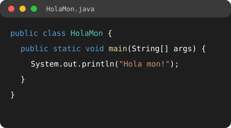

# Programació en Java per a principiants

Hola! Esta web és una guia xicoteta per a començar a programar en **Java**. L'he feta per al *Projecte Intermodular* del cicle **Sistemes Microinformàtics i Xarxes (SMX)**.

{ width="450" }

## Què hi ha ací

1. **Introducció**: què és Java i el primer programa.
2. **Conceptes bàsics**: variables, condicionals i bucles.
3. **Referències**: pàgines per a seguir aprenent.

## Per què programar?

- Ajuda a **pensar** pas a pas.
- Serveix per a fer **scripts** i automatitzar tasques.
- Es necessita en molts mòduls del cicle.

!!! note "Nota"
    Esta web està feta amb **MkDocs** i el tema **Material**, i està publicada en *GitHub Pages*.

!!! tip "Consell"
    Per a aprendre a programar, **has de practicar**. Prova tots els exemples en el teu ordinador.
